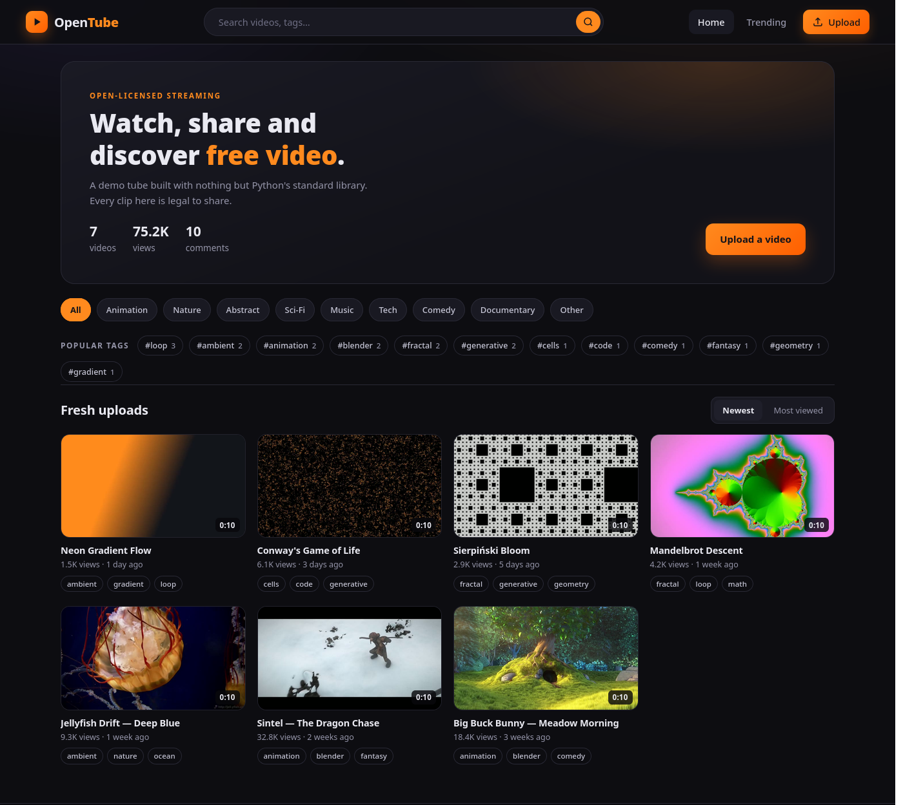
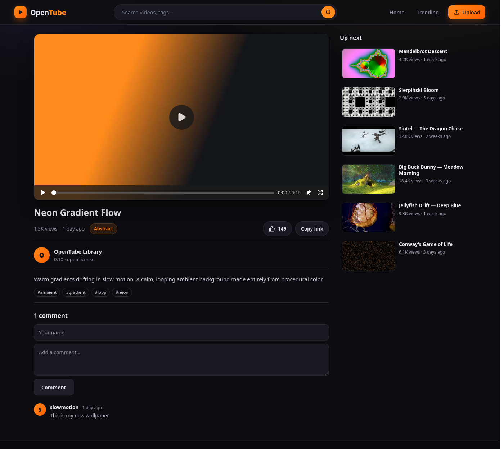
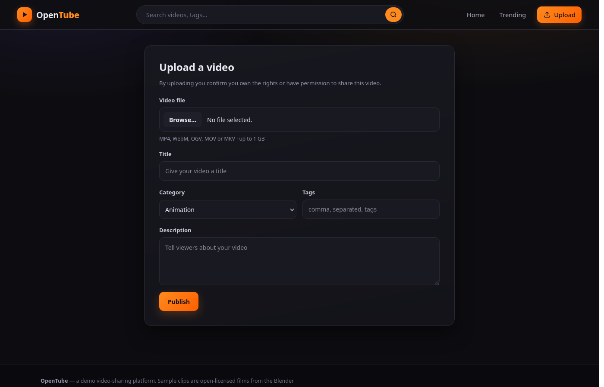

<p align="center"></p>

<h1 align="center">OpenTube</h1>

<p align="center">A self-contained video-sharing site built entirely on the Python standard library.<br>
No dependencies, no build step, no external services — just SQLite, HTTP range streaming, and plain HTML.</p>

<p align="center">
  
  
  
</p>



OpenTube is a demo video platform: a browsable library, search and tag filtering, a player with seeking, uploads with automatic thumbnails, likes, view counts, and comments. It is deliberately dependency-free so it runs anywhere Python does.

## Features

- **Library** — home feed, full-text-ish search over titles/descriptions, category and tag filters, newest/most-viewed sorting, pagination
- **Player** — HTML5 video with poster frames, byte-range streaming (seek anywhere), `HEAD` support
- **Uploads** — streamed multipart parsing to disk (1 GB cap), extension validation, `ffprobe` duration detection, `ffmpeg` thumbnail extraction, SVG placeholder fallback
- **Social** — view counts, per-browser like toggle, threaded-by-time comments
- **Storage** — SQLite with tags, joins, and indexes; schema auto-created on first run
- **UI** — dark responsive layout, XSS-escaped output, path-traversal-safe media serving
- **Seed data** — seven legal, openly licensed sample clips with thumbnails and realistic stats

## Quick start

Requirements: **Python 3.10+** and **ffmpeg/ffprobe** (used by the seed script and for upload thumbnails). Nothing to install.

```bash
git clone git@github.com:trix-linux/opentube.git
cd opentube
python3 seed.py
python3 server.py
```

Open <http://127.0.0.1:8000>.

`seed.py` downloads three ~2 MB open-licensed clips and renders four more with `ffmpeg` into `media/` (about 35 MB total). Re-run with `--force` to wipe the library and reseed.

```bash
python3 server.py --host 0.0.0.0 --port 9000
```

| Flag | Default | Meaning |
| --- | --- | --- |
| `--host` | `127.0.0.1` | Bind address |
| `--port` | `8000` | Listen port |

## Screenshots

| Watch page | Upload |
| --- | --- |
|  |  |

## Routes

| Method | Path | Description |
| --- | --- | --- |
| GET | `/` | Home / search (`q`, `category`, `tag`, `sort=new\|popular`, `page`) |
| GET | `/watch/<id>` | Video page, related clips, comments |
| GET | `/upload` | Upload form |
| POST | `/upload` | Multipart upload → redirects to the new video |
| POST | `/api/view/<id>` | Increment view count |
| POST | `/api/like/<id>` | JSON `{"delta": 1}` or `{"delta": -1}` |
| POST | `/comment/<id>` | Form-encoded comment → redirects back |
| GET | `/media/<file>` | Video stream (Range/HEAD supported) |
| GET | `/thumbs/<file>` | Thumbnail images |
| GET | `/static/<file>` | CSS, JS, favicon |

## Project layout

```
opentube/
├── server.py          # HTTP server, routing, streaming, upload parsing
├── views.py           # Server-rendered HTML (layout, home, watch, upload)
├── db.py              # SQLite schema and queries
├── seed.py            # Downloads/renders the sample library
├── slugify.py         # URL slug helper
├── static/
│   ├── style.css
│   ├── app.js         # Views, likes, copy-link
│   └── favicon.svg
├── docs/              # README screenshots
├── data/              # SQLite DB (gitignored)
└── media/             # Uploaded videos + thumbnails (gitignored)
```

## How it works

`server.py` is a `ThreadingHTTPServer` with a small regex route table. Media responses use `Range`/`Content-Range` with `206 Partial Content` so browsers can seek; file paths are resolved through a `safe_join` guard. Uploads are parsed as a stream rather than buffered, so a 1 GB file never sits in memory. After a file lands, `ffprobe` reads its duration and `ffmpeg` grabs a frame for the thumbnail.

Pages are plain strings assembled in `views.py` — no template engine, no framework. All user content is passed through `html.escape`.

Data lives in `data/opentube.db`; videos in `media/videos/`; thumbnails in `media/thumbs/`. Both directories are created automatically and excluded from git.

## Configuration

The useful knobs are constants at the top of the modules:

- `server.py`: `MAX_UPLOAD` (default 1 GiB), `ALLOWED_VIDEO_EXT`, host/port flags
- `db.py`: `CATEGORIES`, default page size (12)
- `seed.py`: source URLs and generated clip specs

## Security & scope

This is a **demo**, not a hardened service. It has no accounts, authentication, authorization, rate limiting, or CSRF protection, and it ships with a development HTTP server. Do not expose it directly to the internet; put it behind a real server and add auth first. Uploaded files are served from the same origin.

## Content credits

The sample library exists to make the demo look alive. All clips are openly licensed:

- **Big Buck Bunny** and **Sintel** — © Blender Foundation, [CC BY 3.0](https://creativecommons.org/licenses/by/3.0/), via [test-videos.co.uk](https://test-videos.co.uk/)
- **Jellyfish** clip — via [test-videos.co.uk](https://test-videos.co.uk/), CC BY 3.0
- **Mandelbrot Descent**, **Sierpiński Bloom**, **Conway's Game of Life**, **Neon Gradient Flow** — generated locally with `ffmpeg` from mathematical/procedural sources (CC0)

Sample media is downloaded/rendered at seed time and is not committed to this repository. OpenTube is an unaffiliated demo project; only upload content you have the rights to.

## License

Code is released under the [MIT License](LICENSE). Sample videos and screenshots remain under their respective licenses above.
